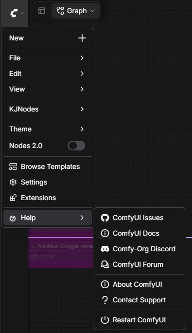

# ⏻ Restarter

A tiny ComfyUI custom node extension that adds a simple restart action to the menu bar.

## Features

- Adds a `Restart ComfyUI` command under the `Help` menu
- Restarts the current ComfyUI server without requiring any nodes
- Preserves the current Python interpreter and launch arguments
- Reloads the browser automatically once the server is back online

## Installation

1. Copy this folder into your ComfyUI `custom_nodes` directory.
2. Restart ComfyUI.
3. Open the `Help` menu and choose `⏻ Restart ComfyUI`.

    

## Notes

- This extension does not register any nodes.
- It is intended as a quick way to restart the UI/server during development or after updates.
